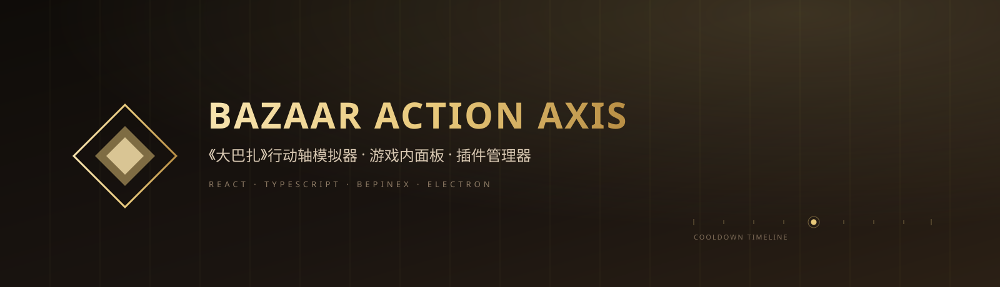

<div align="center">



<h1>Bazaar Action Axis</h1>

<p><strong>《大巴扎》(The Bazaar) 的行动轴推演、游戏内面板与 BepInEx 插件管理器</strong></p>

<p>
  
  
  
  
  
  
</p>

</div>

---

## 这个仓库能做什么

| 模块 | 你能做什么 | 怎么运行 |
| --- | --- | --- |
| **浏览器模拟器** | 编排双方卡组，按冷却轴推演 60 秒，拖动时间轴查看任意时刻的血量、护盾、持续伤害与结算链 | `npm run dev` |
| **游戏内行动轴插件** | 在游戏里直接读取当前棋盘 / 怪物 / 技能，用内置 C# 引擎推演 30 秒并显示在 BPP 风格面板中 | `tools/build_actionaxis_plugin.sh` |
| **桌面插件管理器** | 自动定位 Steam 版游戏，安装 / 卸载 BepInEx 插件，按组清理 BPP 数据、行动轴数据与插件配置 | `plugin-manager/` |

三部分共用同一份卡牌数据 `src/data/cards.json` 和同一套规则基准，可以在网页、游戏内和桌面管理器之间对照验证。

---

## 快速开始

环境：**Node.js 18+**、**Python 3.10+**（仅数据脚本需要）。游戏内插件需要 Windows 与 .NET Framework 自带的 `csc.exe`。

### 浏览器模拟器

```bash
npm install
npm run dev
```

打开终端提示的本地地址即可。`npm run build` 会先做类型检查再生成生产构建。

### 桌面插件管理器

```bash
cd plugin-manager
npm install
npm run dev
```

管理器启动后会自动扫描 Steam 注册表、所有 Steam 库和常见安装位置，找到《The Bazaar》后直接读取 `BepInEx/plugins`。不需要先配置路径。

打包成 portable exe：

```bash
cd plugin-manager
npm run package
# release/Bazaar Plugin Manager-0.1.0-portable.exe
```

详见 [`plugin-manager/README.md`](plugin-manager/README.md)。

### 游戏内行动轴插件

```bash
# 编译并部署到游戏目录（默认读取 D:/Program Files (x86)/Steam/...）
bash tools/build_actionaxis_plugin.sh

# 只编译 / 只跑 C# 测试
bash tools/build_actionaxis_plugin.sh --compile-only
bash tools/build_actionaxis_plugin.sh --test
```

重启 The Bazaar 后，点击右上角 BPP 按钮下方的金框时间轴图标，或按 `F8` 打开面板。

---

## 桌面插件管理器

`plugin-manager/` 是一个独立的 Electron 应用，参考 BazaarPlusPlus 安装器的交互方式，把日常维护集中到一个窗口里。

### 功能

- **自动读取游戏目录**：上次记录 → Steam 注册表 → `libraryfolders.vdf` → `appmanifest_1617400.acf` → 多磁盘常见路径，逐级回退；检测结果写回管理器配置。
- **识别已装插件**：把 BPP 主 DLL、依赖 DLL、版本与历史数据库文件归为一个插件；识别 Bazaar Action Axis（DLL + 数据目录）与 LiveCardsDump；其余目录 / 顶层 DLL 作为外部插件。
- **安装插件**：
  - 一键部署本仓库内置的 Action Axis（含 `cards.json`、`skills.json`、卡图）与 LiveCardsDump；
  - 本地 ZIP：支持 `BepInEx/plugins/...` 结构、单插件文件夹或根目录 DLL；
  - URL：支持 `.zip` 与 `.dll` 直链，最大 200 MB，120 秒超时。
- **卸载插件**：先把文件备份到管理器数据目录，再删除 `BepInEx/plugins` 中的对应文件。
- **数据清理**：按组列出可清理目标，统一移入 Windows 回收站。
- **启动游戏**：优先通过 Steam 启动，失败时直接运行 `TheBazaar.exe`。

### 数据清理范围

| 分组 | 内容 |
| --- | --- |
| BPP 数据 | 游戏目录下 `BazaarPlusPlusV*`、`%APPDATA%/BazaarPlusPlusInstaller`、`%APPDATA%/com.bazaarplusplus.bppinstaller` |
| 行动轴数据 | `BepInEx/plugins/BazaarActionAxis` 下的 `last_*` 快照 / 报告、`combats/`、`icons/` |
| LiveCardsDump 输出 | 仓库 `captures/live_cards_bpp.json`、`live_cards_bpp.error.txt`、`live_loadout.json` |
| BepInEx 配置 | `BepInEx/config` 中 BPP / Action Axis / LiveCardsDump 相关 `.cfg` |

### 安全边界

- 只写 `BepInEx/plugins` 与 `%APPDATA%/bazaar-plugin-manager/backups/`，不修改游戏本体与 `BepInEx/core`。
- 游戏运行中拒绝安装、卸载和清理游戏目录内的数据。
- ZIP 解压拒绝绝对路径与 `..` 穿越，限制 20000 个条目、解压后 500 MB。
- 渲染层启用 `contextIsolation`，只通过 preload 白名单调用主进程；删除路径由主进程重新扫描，不接受渲染层传入的任意路径。

---

## 浏览器模拟器

- **双方卡组编排**：每方最多 10 张卡，可从图鉴导入或完全自定义。
- **冷却轴模拟**：0.1 秒步长、最长 60 秒；支持加速、减速、冻结、充能、多重施放、弹药 / 装填、灼烧、中毒、再生、暴击、吸血、护盾和触发链。
- **可拖动时间轴**：播放头可拖动，支持播放 / 暂停与 0.5×–4× 倍速。
- **总量统计**：双方总伤害、有效伤害、治疗、护盾、DPS。
- **触发详情**：点击触发点查看同一条 `chainId` 的完整结算链；点击卡牌查看该卡的全部事件。
- **自定义卡牌**：名称、品阶、冷却、弹药、标签、图片、效果行均可编辑，保存在 `localStorage`。
- **数据驱动**：卡牌来自游戏原始数据库 + 大巴扎图鉴，导入时分级解析。

### 规则基准 v1

所有数值集中在 `src/engine/rules.ts`，可在 `RuleOverrides` 中覆盖。

| 机制 | 规则 |
| --- | --- |
| 时间步长 | 0.1 秒，上限 60 秒 |
| 初始冷却 | 以基础冷却开始；`startReady` 的卡从 0 开始 |
| 触发 | 冷却归零即激活，激活后重置为基础冷却 |
| 同 tick 排序 | 我方从左到右，再对方从左到右 |
| Haste / Slow | 持续 N 秒，冷却速率 ×2 / ×0.5 |
| Freeze | 持续 N 秒，冷却暂停 |
| Charge | 立即减少 N 秒剩余冷却 |
| 伤害 | 先扣护盾，溢出扣生命 |
| 暴击 | 概率触发，伤害 / 治疗 / 护盾 ×2 |
| 吸血 | 按实际生命伤害回复 |
| 灼烧 | 每 1 秒造成等于层数的伤害，层数 −1 |
| 中毒 | 每 1 秒造成等于层数的伤害，不衰减 |
| 再生 | 每 1 秒回复等于层数的生命 |
| 多重施放 | 一次激活连续结算 N 次 |
| 弹药 | 每次施放消耗 1 发；0 发时等待装填 |
| 结束 | 一方生命 ≤ 0 立即结束；60 秒按剩余生命百分比判定 |

规则证据来自 BazaarPlusPlus 的战斗归因语料（1110 场 / 339,649 帧）：灼烧会打护盾并衰减、中毒不衰减、再生每 tick、暴击作用于伤害 / 治疗 / 护盾、死亡立即结束。诊断样本保留在 `captures/diagnostics/`。

---

## 读取游戏当前卡牌

三种方式，按精确度从高到低。

### 1. LiveCardsDump 插件（最精确）

BPP 的 `internal` `LiveCardSnapshotReader` 不对外暴露。本仓库带一个小型 BepInEx 伴随插件，反射调用它并把商店 / 棋盘 / 仓库写成 JSON。

```bash
bash tools/build_livecards_plugin.sh
```

脚本用系统 `csc.exe` 编译（不需要 .NET SDK），并把 `LiveCardsDump.dll` 复制到 `BepInEx/plugins/`。**重启 The Bazaar** 后每 2 秒写一次：

```
captures/live_cards_bpp.json
```

再映射成模拟器卡牌 ID：

```bash
python tools/import_live_cards.py
# 输出 captures/live_loadout.json
```

插件没生效时，检查游戏 `BepInEx/LogOutput.log` 与 `captures/live_cards_bpp.error.txt`。输出目录按本仓库位置写在 `LiveCardsDump.cs` 中；克隆到其他位置时需修改后重新编译。

### 2. 悬停 tooltip + Windows OCR（不改游戏）

```bash
python tools/read_current_cards.py
# 输出 captures/live/live_cards.json + 每张卡的截图
```

工具会把游戏置前，依次悬停 5 个商店卡位，截图 tooltip，用 Windows 自带 `Windows.Media.Ocr` 识别中文名，再匹配到 `data/items_raw.json` / `src/data/cards.json`。

- `--from-captures <目录>`：使用目录中已有的 `hover_card*.png` 离线测试，不用开游戏。
- `--capture-only`：只截图，不做 OCR。
- 卡位和 tooltip 框按 1616×1063 校准；窗口大小会等比缩放，UI 大改时需要调整 `SLOTS` / `TOOLTIP_BOXES`。
- 图鉴没有的新卡会返回名字但没有 `matchedId`，可在模拟器里作为自定义卡补录。

### 3. 完整 GameData.db（静态卡池）

游戏 `TheBazaar_Data/StreamingAssets/GameData.db.zip` 里有完整卡牌库。解压后：

```bash
python tools/import_game_db.py --db vendor/GameData/GameData.db --out data/game_cards_full.json
npm run cards
```

1146 件物品，其中 1041 件与图鉴 GUID 重合，远多于 BPP 仓库自带的 116 件裁剪库。

---

## 游戏内行动轴插件

独立的 BepInEx 伴生插件 `BazaarActionAxis`，在游戏内直接读取当前棋盘并模拟行动轴。

### 面板与交互

- 点击右上角 BPP 按钮下方的金框时间轴图标，或按 `F8` 打开 / 关闭面板；位置按当前可见的数据库 / 录制按钮动态排列。
- 自动读取 BPP 当前棋盘并映射到 `cards.json`，用内置 C# 引擎推演 30 秒，打开默认显示第 15 秒。
- BPP 棕金风格面板，按棋盘实际位置和占格显示小 / 中 / 大卡（1 / 2 / 3 格）。
- 可拖动时间轴；伤害、护盾、中毒等累计效果在卡牌中间竖排居中，底部显示 `xN` 触发次数。
- 主栏显示累计输出与 DPS，只计我方直伤、灼烧与中毒，不计敌方自伤、治疗、过量伤害；敌方回复单列。
- 卡牌不显示 CD 数字，冷却通过由下向上涨的水平水位表示，跟随加速、减速、冻结和充能变化。
- 打开面板时拦截底层游戏输入，收起后恢复，避免拖动时间轴时误点游戏。

### 棋盘、怪物与技能

- 棋盘读取 BPP 当前棋盘、人物属性、技能、品质、附魔与实时数值。
- 三选怪物界面会读取三个怪物的原生卡组、品质、附魔、技能与生命，默认模拟中间一只；点击对手头像处的切换按钮轮换，新一组选项自动恢复默认中间。
- 怪物的物品和技能主动参与计算，包括已支持的初始再生、护盾、静态光环和控制效果；未完整支持的规则列入模拟警告。
- 未处于怪物选择 / 详情界面时，使用随机展示卡组的木桩；木桩不主动攻击，展示牌仍可作为冻结等效果的目标。
- 已获得的技能、开战 / 使用物品触发技能参与战斗计算，技能效果单独显示累计统计；战斗外技能、条件未满足和未支持规则分别标明。

### 数值、联动与实战对照

- 游戏内推演采用 50 毫秒步长、每半秒灼烧及 3% 衰减、毒伤穿盾、灼烧护盾减免、每 250 毫秒的多重触发和叠加状态时长。
- 发射核心、齿轮、机械红焰萤、昏沉滴露、航空护目镜等联动按当前原生模板校准；尚未校准的卡会列入模拟警告。
- 发射核心的被动会在其他伙伴或飞行物品使用后为自己充能 1 秒，自己的使用不会触发这条被动。
- 读取当前附魔的原生定义与实时属性，附魔新增的使用时效果参与计算；已反映到实时数值的光环不重复加算。
- 在原生实战回放中额外读取真实逐帧记录，按同一时间轴显示对手生命、净失血、实际承伤、回复和护盾吸收；承伤来自原生生命 / 护盾扣减记录，包含过量伤害及沙暴。
- 角标按效果结算次数统计，与目标数量无关。

### 卡图与数据文件

- 无卡图时显示完整名称；每次打开 / 重新记录时尝试补全缺失卡图，保存 PNG 后续复用，不同附魔单独保存。
- 卡图保存在 `DataDir/icons/`：无附魔 `<baseItemId>.png`，附魔 `<baseItemId>--enchant-<附魔名小写>.png`；已有资源不覆盖。
- 每次打开 / 重新记录保存 `DataDir/last_snapshot.json`、`last_skill_report.txt`、`last_monster_choices.json`、`last_monster_report.txt`。
- 运行期间每两秒检查原生实战回放，完整帧就绪后保存 `DataDir/last_combat_replay.json` 与 `DataDir/combats/<combatId>.json`。

### 构建与部署

```bash
# 可选：预先生成卡图
python tools/build_card_icons.py

# 可选：导出完整技能模板与本地中文翻译
python tools/export_skill_catalog.py

# 编译并部署 DLL + cards.json + icons
bash tools/build_actionaxis_plugin.sh
```

部署位置：

```
<GameDir>/BepInEx/plugins/ActionAxisPlugin.dll
<GameDir>/BepInEx/plugins/ActionAxisEngine.dll
<GameDir>/BepInEx/plugins/BazaarActionAxis/cards.json
<GameDir>/BepInEx/plugins/BazaarActionAxis/skills.json
<GameDir>/BepInEx/plugins/BazaarActionAxis/icons/*.png
```

重启 The Bazaar 后生效。热键和 `DataDir` 可在 `BepInEx/config/com.bazaarsim.actionaxis.cfg` 中修改。

### 限制

- 卡牌水位、触发和中部统计属于本地推演；怪物选择页使用读取的怪物对战，其余场景使用木桩。
- 随机选卡暂未复用游戏原生随机种子；全卡池的复杂联动尚未完全校准，推演数字不能保证逐帧复现实战。
- 附魔支持可映射的原生使用时效果；复杂触发、动态光环等未支持组合会保留原效果并给出警告。
- 技能映射采用已支持的原生触发器、动作和条件；复杂条件、次数限制等未支持组合会明确显示「规则待支持」。
- 自动补图仅覆盖游戏内已遇到且能读取原生卡面的卡牌。

---

## 数据来源与许可

| 来源 | 内容 | 许可 / 说明 |
| --- | --- | --- |
| `bazaarwinner.com` 图鉴 | 1043 件物品的中英文名、图片、品阶、tooltip | 仅本地个人使用；对外分发请自行确认授权 |
| 游戏安装目录 | `GameData.db` 中 1146 件 `TCardItem` 的结构化能力 | 游戏数据版权归 Tempo 所有，仅本地个人使用 |
| `BazaarPlusPlus` 仓库 | 裁剪版 `GameData.cards.db`（116 件）与战斗归因语料 | MIT；本地参考目录不随本仓库分发 |
| 《The Bazaar》 | 物品与规则版权归 Tempo 所有 | 本项目为个人学习 / 推演工具，不包含游戏本体 |

`vendor/BazaarPlusPlus` 只作为离线数据源和规则核对，不参与应用构建，也不从中执行脚本。克隆仓库后如需复现数据脚本，请自行获取对应仓库与游戏数据。

---

## 项目结构

```
src/engine/          纯 TypeScript 战斗引擎（无 React）
src/components/      时间轴、卡组、编辑器、详情、总量面板
src/state/           模拟器状态与 localStorage 持久化
src/data/            生成的卡牌库与解析报告
plugin-manager/      Electron 桌面管理器：自动定位游戏、安装 / 卸载插件、清理数据
tools/               数据提取、OCR、插件源码与构建脚本
data/                图鉴与游戏库的中间数据
docs/                规格、实现计划与 README 横幅
captures/            Action Axis 卡图资源与规则诊断样本
vendor/              本地第三方参考（不随仓库分发）
```

---

## 开发命令

| 命令 | 说明 |
| --- | --- |
| `npm run dev` | 启动模拟器开发服务器 |
| `npm run build` | 类型检查 + 生产构建 |
| `npm test -- --run` | 模拟器 Vitest |
| `npm run cards` | 重新生成卡牌库 |
| `python -m unittest tools.test_import_game_db tools.test_download_images -v` | 数据脚本测试 |
| `cd plugin-manager && npm run dev` | 启动桌面管理器 |
| `cd plugin-manager && npm test` | 管理器 Vitest（20 个测试） |
| `cd plugin-manager && npm run package` | 打包 portable exe |
| `bash tools/build_actionaxis_plugin.sh` | 编译并部署游戏内插件 |
| `npx tsx tools/export_engine_fixtures.ts` | 重新生成 C# 引擎测试的 TS golden fixtures |

---

## 已知限制

- **完整游戏库 1146 件**，其中 1041 件与图鉴 GUID 重合；105 件为游戏库独有（英文名、无图片）。
- **结构化覆盖**：当前 3620 张卡中约 755 张为 `structured`，其余为 `partial`（主效果可用，条件 / 经济文本保留在 `rawTooltips`）或 `text`。
- **复杂效果**：`ModifyAttribute`、`SpawnCards`、`Flying`、附魔等 v1 只标记 `partial`，不做完整模拟。
- **Sandstorm**：语料确认存在，但仓库没有具体公式；v1 默认关闭，`RuleOverrides.sandstorm` 预留配置位。
- **图片**：默认热链 CDN；离线使用需运行下载脚本，并自行确认图片授权。
- **管理器**：只管理 `BepInEx/plugins`，不安装 BepInEx 本体；不解析 DLL 元数据，插件名称来自已知清单或文件名。
- **不是游戏本体**：不包含任何游戏程序集或反编译代码。

---

## 致谢

|  |  |
| --- | --- |
| **灵感与参考** | [BazaarPlusPlus](https://github.com/BazaarPlusPlus/BazaarPlusPlus) · [BazaarHelper](https://github.com/Duangi/BazaarHelper) · [BazaarPlannerMod](https://github.com/oceanseth/BazaarPlannerMod) |
| **数据来源** | [bazaarwinner.com](https://bazaarwinner.com) 图鉴 · 游戏本地 `GameData.db` |
| **运行依赖** | [BepInEx](https://github.com/BepInEx/BepInEx) · [Harmony](https://github.com/pardeike/Harmony) · [React](https://react.dev) · [Vite](https://vite.dev) · [Electron](https://www.electronjs.org) |
| **游戏** | [The Bazaar](https://www.playthebazaar.com) · 版权归 Tempo 所有 |

<div align="center">
  <sub>个人学习与推演工具 · 不包含游戏本体 · 请遵守 The Bazaar 官方 Mod Policy</sub>
</div>
